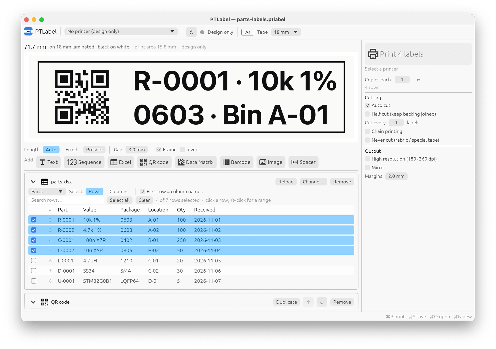

<div align="center">


# PTLabel

**Fast native label app & CLI for Brother P-touch printers on macOS and Windows.**

[Download](https://github.com/Ntrondle/ptlabel/releases/latest) · [CLI Reference](docs/CLI.md)

<br />



</div>

## Install

Download the latest release from **[GitHub Releases](https://github.com/Ntrondle/ptlabel/releases/latest)**:

- **macOS (Apple Silicon):** `PTLabel-…-macos-arm64.dmg` — drag to Applications.
- **Windows:** `PTLabel-…-windows-x86_64.exe` — standalone executable, no installer required.

Once installed, the application will check for updates and prompt when a new version is available.

## Features

- **Live tape detection** — reads cassette width, type, and tape/ink colours from the printer in real time.
- **Composable blocks** — multi-line text (any system font, auto-fit or pt size, `0/90/180/270°` rotation), QR, Data Matrix (square or rectangular for narrow tape), Code 128/39, EAN-13/8, UPC-A, images (threshold or dither), number sequences, and spacers.
- **Spreadsheet support** — open `.xlsx`, `.xlsm`, `.xlsb`, `.xls`, `.ods`, or `.csv` files, you can then insert a `{Column}` field.
- **Templates & sequences** — dynamic `{n}`, `{n:03}`, `{seq}` / `{seq2}`, `{date}`, and `{time}` placeholders across text, QR, and barcodes.
- **Layout & output** — auto or fixed length, frame, invert, high-res `180×360` dpi, mirror, chain printing, half-cut & cut-every-N (PT-E550W), PNG export, and `.ptlabel` JSON files.

## Printers

> [!IMPORTANT]
> PTLabel has only been tested on the **PT-E550W** and **PT-P710BT**. Other P-touch models share the same Brother raster protocol and should work, but are untested — please open an issue if you run into any quirks.

| Connection | Supported models | Notes |
| --- | --- | --- |
| **Wi-Fi** | PT-E550W, PT-P750W | Auto-discovered over mDNS/Bonjour, or enter an IP address directly. |
| **Bluetooth** | PT-P710BT | Pair once in OS Bluetooth settings — PTLabel connects directly. *(macOS: don't click **Connect** in System Settings, or macOS grabs the printer as a braille display. |
| **USB** *(Windows)* | PT-P710BT, PT-E550W, PT-P750W, PT-P700, PT-D600, PT-P900 series, and other P-touch models | Plug-and-play over Windows' built-in `usbprint.sys` driver (no Zadig/WinUSB needed). |

## CLI

The app binary can doubles as a headless CLI for scripts (`list`, `status`, `render`, `print`). See [`docs/CLI.md`](docs/CLI.md) for the full reference and `.ptlabel` schema.

```sh
ptlabel list
ptlabel status 192.168.1.160
ptlabel render --tape 24 --label examples/asset-tag.ptlabel --out tag.png
ptlabel print 192.168.1.160 --copies 3 --half-cut 'Hello\nworld'
ptlabel print usb --label examples/asset-tag.ptlabel          # Windows USB
ptlabel print /dev/cu.PT-P710BT6431 --label examples/asset-tag.ptlabel
```

## Build from source

Built in Rust with `egui` (Metal on macOS, DX12 on Windows).

```sh
scripts/bundle.sh --install   # macOS: build & install to ~/Applications/PTLabel.app
scripts/bundle.sh --dmg       # macOS: build target/PTLabel.dmg
cargo build --release         # Windows: target/release/ptlabel.exe
cargo test
```

## Credits

PTLabel is built with many open-source Rust crates, including:

- **[egui / eframe](https://github.com/emilk/egui)** (Emil Ernerfeldt & contributors) & **[wgpu](https://github.com/gfx-rs/wgpu)** — native GUI and Metal/DX12 rendering
- **[cosmic-text](https://github.com/pop-os/cosmic-text)** (System76 / Jeremy Soller) — system font discovery and text shaping
- **[calamine](https://github.com/tafia/calamine)** (Johann Tuffe) — Excel and OpenDocument spreadsheet parsing
- **[qrcode](https://github.com/kennytm/qrcode-rust)**, **[datamatrix](https://github.com/jannschu/datamatrix-rs)**, **[barcoders](https://github.com/buntine/barcoders)**, and **[image](https://github.com/image-rs/image)** — 1D/2D barcode generation and image processing
- **[mdns-sd](https://github.com/keepsimple1/mdns-sd)**, **[objc2](https://github.com/madsmtm/objc2)**, **[windows-sys](https://github.com/microsoft/windows-rs)**, **[serialport](https://github.com/serialport/serialport-rs)** (MPL-2.0), **[rfd](https://github.com/PolyMeilex/rfd)**, and **[ureq](https://github.com/algesten/ureq)** — networking, Bluetooth/USB transports, native dialogs, and self-updates

See [`THIRD_PARTY_LICENSES.txt`](THIRD_PARTY_LICENSES.txt) for the full list of dependencies, copyright notices, and license texts.

## License

PTLabel is licensed under the [MIT License](LICENSE).

> Brother and P-touch are registered trademarks of Brother Industries, Ltd. PTLabel is an independent project and is not affiliated with or endorsed by Brother.
